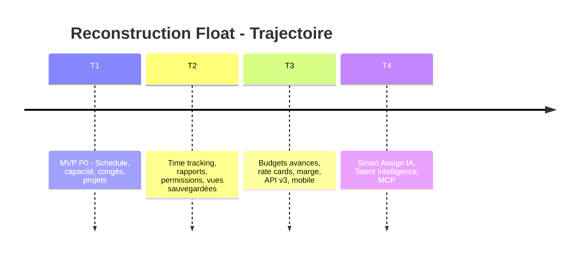

# 🌊 Reconstruire Float.com — Dossier de fondamentaux produit

**Document compilé par le CPTO** · Synthèse des travaux de l'architecte, de l'UX/UI senior et du PM senior
Date : octobre 2026 · Version 1.0

---

## 0. Executive summary (CPTO)

**Float est le logiciel n°1 de gestion de ressources pour équipes de livraison** (agences créatives, services professionnels, équipes produit internes). Plus de 4 500 équipes l'utilisent, dont Atlassian, Ogilvy, Deloitte, BuzzFeed, KPMG, M&C Saatchi.

**La thèse produit en une phrase :** *le planning de ressources est le système de vérité de la livraison — il connecte les personnes, les projets et l'argent en temps réel, à côté du CRM, de l'outil PM et de la finance, sans les remplacer.*

**Les 5 fondamentaux à reconstruire :**

1. **Schedule** — un planning visuel drag-and-drop (personnes × jours) avec code couleur par projet
2. **Capacity** — disponibilité calculée (heures ouvrées − congés − jours fériés), indicateurs de sur/sous-allocation et alertes de conflit
3. **Projects & Budgets** — scoping projet (client, phases, tâches, budget, baseline), facturable vs non-facturable vs tentatif
4. **Time tracking** — timesheets pré-remplies depuis le planning, verrouillables, comparaison planifié vs réel
5. **Reports & Forecast** — utilisation, surtemps, marges, burn budget, forecasts de capacité

**Positionnement et modèle économique :** SaaS B2B, tarification *par personne planifiée* (pas par utilisateur actif) — Starter ≈ 7–8 $, Pro ≈ 12–14 $ par personne/mois, Enterprise sur devis. Trial de 30 jours, illimité en personnes. B Corp depuis 2024, SOC2 & GDPR. Cap produit actuel : **Talent Intelligence & AI-assisted staffing** (recommandations de staffing, ISO 42001 en cours).

---

## 1. Recherche — Ressources & captures d'écran (CPTO)

### 1.1 Sources officielles (produit, pricing, vision)

| Ressource | URL | Ce qu'on y trouve |
|---|---|---|
| Page d'accueil Float | https://www.float.com/ | Positionnement, 3 piliers (People / Projects / Performance), témoignages clients |
| Resource Scheduling (produit) | https://www.float.com/product/scheduling | Le cœur : Schedule, code couleur, tags, vues sauvegardées |
| Capacity Planning (produit) | https://www.float.com/product/capacity-planning | Indicateurs d'utilisation, alertes de sur-capacité |
| Time Tracking (produit) | https://www.float.com/product/time-tracking | Timesheets pré-remplies, verrouillage, deadlines & rappels |
| Float x AI / Talent Intelligence | https://www.float.com/ai | Vision AI : recommandations de staffing, conflits, marges |
| Pricing | https://www.float.com/pricing | Plans Starter / Pro / Enterprise, modèle par personne planifiée |
| Help Center | https://support.float.com | Glossaire, rapports, règles de gestion détaillées |
| API v3 | https://developer.float.com | Toutes les entités du modèle de données |
| Blog produit (Medium) | https://medium.com/float-news | Historique des évolutions (ex. refonte Reports) |

### 1.2 Captures d'écran de l'interface (pour reconstituer les fondamentaux)

| Source | URL | Captures disponibles |
|---|---|---|
| Revue détaillée The Digital Project Manager (FR) | https://thedigitalprojectmanager.com/fr/tools/revue-float/ | Screenshots du Schedule, indicateurs de capacité, revue UX complète |
| Revue Productivity Land | https://productivityland.com/float-resource-scheduling-software-review-pricing-and-features/ | Capture du Schedule + vue Reports |
| App Store iOS | https://apps.apple.com/us/app/float-resource-management/id1318992940 | Screenshots mobile (Schedule, timesheets, congés) |
| SelectHub | https://www.selecthub.com/p/resource-management-software/float-com/ | Captures testées : Smart Assign, budgets, code couleur |
| Capterra | https://www.capterra.com/p/136078/Float/reviews/ | Galerie produit + retours UX |
| G2 | https://www.g2.com/products/float-com/reviews | Galerie produit, fonctionnalités par plan |

> ⚠️ Ces captures appartiennent à Float et aux sites de revue. Pour la reconstruction, s'en servir comme **référence de design et d'ergonomie**, pas comme assets à copier.

### 1.3 Ce que disent les utilisateurs (signal produit)

- **Ce qui est aimé** : interface claire et rapide (« lightning fast »), drag-and-drop, code couleur, indicateurs de capacité en un coup d'œil, « planifier en un clic », raccourcis clavier, filtres puissants.
- **Points faibles à corriger dans notre rebuild** : reporting avancé limité sans export, learning curve initiale, expérience mobile parfois bancale (popups non fermables), intégrations natives limitées.
- **Impacts clients documentés** : +50 % d'efficacité de resourcing, livraison à l'heure passée de 40 % à 90 %, +33 % d'heures loggées en 6 mois.

---

## 2. Le produit décortiqué — modules fondamentaux

| Module | Rôle | Éléments clés |
|---|---|---|
| **Schedule** | Planning visuel ressources | Vue personnes × jours/semaines/mois, blocs d'allocation, drag-and-drop, code couleur par projet, tags, filtres, vues sauvegardées, recherche, raccourcis clavier |
| **People & Capacity** | Disponibilité réelle | Jours et heures ouvrés par personne, congés, jours fériés, placeholders (ressources fictives), départements, rôles, tags de compétences, indicateurs sur/sous-allocation |
| **Projects** | Scoping & budgets | Client, phases, tâches projet, milestones, budget (5 types), baseline, facturable/tentatif/non-facturable, taux de coût et de facturation |
| **Time tracking** | Réel vs planifié | Timesheets pré-remplies depuis les allocations, timer optionnel, notes, verrou après soumission, deadlines & rappels |
| **Reports** | Pilotage | Rapports People (capacité, heures planifiées/loggées, congés, surtemps, % d'utilisation), Projects (budget burn, planifié vs réel, marge), Logged, export CSV/Excel |
| **Integrations** | Écosystème | Slack, Jira, Asana, Trello, Google Calendar, Outlook, Zapier, API REST v3, MCP, webhooks/CSV |
| **Mobile** | Accès terrain | Schedule en lecture, log de temps en quelques taps, demandes de congés, alertes |

---

## 3. 🏗️ Architecte — Modèle de données

> Source primaire : la documentation de l'API v3 de Float (https://developer.float.com/api_reference.html), qui expose exactement les entités du produit : Accounts, Departments, People, Roles, Statuses, Time Off, Time Off Types, Public Holidays, Team Holidays, Clients, Projects, Phases, Project Stages, Project Tasks, Project Expenses, Currencies, Rate Cards, Milestones, Allocations (Tasks), Logged Time, Delete Log, Reports.

### 3.1 Diagramme entité-relations

```mermaid
erDiagram
  ACCOUNT ||--o{ DEPARTMENT : regroupe
  ACCOUNT ||--o{ RATE_CARD : definit
  ACCOUNT ||--o{ CURRENCY : gere
  ACCOUNT ||--o{ HOLIDAY : publie
  DEPARTMENT ||--o{ PERSON : emploie
  PERSON }o--|| ROLE : a
  CLIENT ||--o{ PROJECT : commande
  PROJECT ||--o{ PHASE : decoupe
  PROJECT ||--o{ PROJECT_TASK : definit
  PROJECT ||--o{ MILESTONE : jalonne
  PHASE ||--o{ PROJECT_TASK : porte
  PROJECT ||--o{ ALLOCATION : planifie
  PHASE ||--o{ ALLOCATION : porte
  PROJECT_TASK ||--o{ ALLOCATION : nomme
  PERSON ||--o{ ALLOCATION : execute
  PERSON ||--o{ LOGGED_TIME : saisit
  PROJECT ||--o{ LOGGED_TIME : recoit
  PERSON ||--o{ TIMEOFF : pose
  TIMEOFF_TYPE ||--o{ TIMEOFF : categorise
  RATE_CARD ||--o{ RATE : contient
  PERSON ||--o{ RATE : facture
  ALLOCATION {
    int id
    int people_id
    int project_id
    date start_date
    date end_date
    float hours_per_day
    int status
    bool billable
    string name
    string notes
    int repeat_state
    date repeat_end_date
  }
  PERSON {
    int id
    string name
    string email
    string people_type
    int department_id
    int role_id
    string work_days_hours
    float capacity_per_day
    string tags
    float cost_rate
    bool active
  }
  PROJECT {
    int id
    int client_id
    string name
    string project_code
    string color
    date start_date
    date end_date
    int project_manager_id
    string budget_type
    float budget_amount
    int status
    bool non_billable
    string tags
  }
  LOGGED_TIME {
    int id
    int people_id
    int project_id
    date date
    float hours
    bool billable
    string notes
  }
  TIMEOFF {
    int id
    int people_id
    int timeoff_type_id
    date start_date
    date end_date
    bool full_day
    float hours_per_day
    int approval_status
  }
```

### 3.2 Définition des entités (spécification)

**ACCOUNT** (tenant) — l'entreprise. Working days/heures par défaut, timezone, devise, plan, réglages de rapport (semaine de 37,5 h, etc.).

**DEPARTMENT** — équipe (Design, Dev, Stratégie…). Utilisé pour regrouper le planning et les rapports.

**PERSON** — une ressource planifiable. Trois `people_type` : `employee`, `contractor`, `placeholder`. Champs essentiels : `work_days_hours` (ex. `[0,4,4,4,0,0,0]` = 4h du lundi au mercredi), rôle, département, tags de compétences, taux de coût (interne), avatar, e-mail, `active`. *Règle : toute personne présente sur le Schedule est un siège payant, même sans accès au produit.*

**ROLE** — fonction (Designer Senior, Dev, PM…). Utilisé dans les rapports People (regroupement par rôle) et les rate cards.

**RATE_CARD + RATE** — grilles tarifaires par rôle : taux de coût et taux de facturation, par devise et période (années de validité). Sert au calcul de marge des projets.

**CLIENT** — donneur d'ordre. `name`, `short_name`, contacts, tags. Les projets s'y rattachent ; les rapports peuvent regrouper par client.

**PROJECT** — l'unité de travail commerciale. Champs : `client_id`, `name`, `project_code` (référence, ex. `job-12345/11`), `color` (le code couleur du planning !), dates de début/fin, `project_manager_id`, budget (`budget_type` + montant), statut (tentatif / planifié / en cours / terminé), `non_billable`, tags, notes. `project_team` : liste de `people_id` pour pré-affecter une équipe. Baseline = version figée du budget initial.

**PHASE** — découpage d'un projet (Discovery, Design, Dev…). Dates propres, statut, couleur, `non_billable` propre. Hérite des dates projet par défaut.

**PROJECT_TASK** — catégorie de travail nommée au sein d'un projet ou d'une phase (« Design », « Concepting »). Sert à nommer les allocations et à pré-remplir le log de temps.

**MILESTONE** — jalon daté au niveau projet ou phase.

**ALLOCATION** (appelée *task* dans l'API v3 de Float) — **l'entité pivot du produit**. Une allocation planifie : *qui* (`people_id`, parfois multi-personnes via `people_ids`), *sur quoi* (`project_id`, optionnellement `phase_id` et `project_task`), *quand* (`start_date`/`end_date`), *combien* (`hours` par jour, ou `%` de capacité), `billable`, `status` (tentative vs confirmée), `repeat_state` (quotidienne/hebdo/mensuelle + `repeat_end_date`), `priority`, `name`, `notes`, `created_by`/`modified_by` (audit). C'est le bloc visualisé dans le Schedule.

**LOGGED_TIME** — temps réel saisi (timesheet). `people_id`, `project_id`, `phase_id`, `task_id` (catégorie), `date`, `hours` (décimal), `billable`, `notes`. Statuts de workflow : brouillon → soumis → approuvé/verrouillé.

**TIMEOFF + TIMEOFF_TYPE** — congés (vacances, maladie, formation…). `full_day` ou `hours_per_day` (demi-journées), workflow de demande/approbation avec vue de disponibilité de l'équipe.

**HOLIDAY** (public holidays / team holidays) — jours fériés par pays et par équipe, déduits de la capacité.

**Entités transverses :** `STATUS` (libellés de statuts personnalisés), `PROJECT_EXPENSE` (dépenses projet), `CURRENCY`, `DELETE_LOG` (stream des suppressions pour les syncs externes — design d'API moderne à conserver), permissions (Owner, Admin, Project Manager, Team Member, Guest).

### 3.3 Choix d'architecture recommandés

- **Stack de reconstruction** : SPA temps réel (React + WebSocket/SSE), backend REST type API v3 (JSON, pagination par page ou curseur, tri `-champ` pour descendant), Postgres (forte contrainte d'intégrité), cache par tenant.
- **Règle de calcul clé — la capacité** : `capacité journalière = work_days_hours[jour]` ; `disponibilité = capacité − congés − jours fériés` ; le Schedule affiche `Σ allocations vs disponibilité` par jour avec statut sous-allocation / OK / sur-allocation.
- **Temps réel** : toute mutation d'allocation, de congé ou de projet doit se propager en < 1 s à tous les clients connectés (c'est le différentiateur historique de Float face aux tableurs).
- **Performances** : le planning est une matrice creuse `personnes × jours` ; privilégier un rendu virtualisé (canvas/DOM virtualisé) pour 300+ personnes × 12 mois.
- **Auditabilité** : `created_by`/`modified_by`/`created`/`modified` sur toutes les entités mutables + delete log.

---

## 4. 🎨 UX/UI Senior — Ergonomie ultra-fluide & DA

### 4.1 Les 8 principes d'ergonomie (inspirés de ce que Float fait de mieux, corrigés de ses faiblesses)

1. **Une seule surface de vérité.** Le Schedule est l'écran par défaut. Personnes en lignes, jours en colonnes, tout le produit vit autour de cette matrice. Pas de navigation labyrinthique : Schedule, Projects, People, Time tracking, Reports — 5 onglets, terminé.
2. **Tout se fait en drag-and-drop.** Créer, déplacer, étirer (poignées aux extrémités des blocs), dupliquer, splitter une allocation. Toute action planifiée doit être réalisable sans ouvrir de modal : le clic ouvre un popover contextuel, pas une page.
3. **Temps réel et réactivité perçue.** Latence < 100 ms sur les interactions locales (optimistic UI), sync live sans refresh. Micro-interactions de confirmation (le bloc « atterrit » avec un léger rebond), curseur contextuel selon l'action.
4. **L'information en un coup d'œil.** Code couleur par projet, opacité/motif pour le tentatif, barre de capacité sous chaque nom (vert = OK, orange = limite, rouge = surbooké), congés affichés en blocs distincts. Le code couleur des avertissements de surbooking doit rester **non intrusif mais immédiatement identifiable**.
5. **Zéro friction de saisie.** Timesheets pré-remplies depuis le planning : l'équipe *confirme* (« Yep, that's what I did ») au lieu de ressaisir. Raccourcis clavier pour tout (navigation, copier-coller d'allocations, undo/redo). Recherche instantanée + filtres combinables (tags, département, projet, client) + **vues sauvegardées**.
6. **Progressivité.** Simple par défaut, puissant en option : un nouveau client voit un planning ; les réglages fins (répétitions, % de capacité, baselines, rate cards) se révèlent au fur et à mesure. Éviter le piège Float des premiers jours : « interface écrasante pour les petits projets » → proposer un mode compact.
7. **Mobile = lecture + 3 actions rapides.** Voir son planning, logger son temps en 2 taps, demander un congé. Corriger le défaut signalé chez Float : jamais de popup sans bouton fermer.
8. **Confiance par l'annulabilité.** Undo global (tout au moins une action), confirmations douces (toast avec « Annuler »), jamais de suppression silencieuse d'allocations sans avertissement.

### 4.2 Parcours fondamentaux à fluidifier en priorité

**North star UX :** « placer le bon talent sur le bon projet en moins de 10 secondes, avec la certitude de ne surbooker personne ».

### 4.3 Direction artistique — simple mais efficace

- **Tonalité** : outil professionnel épuré, sans décoration gratuite. Float cultive l'effet « wow » par la vitesse et la clarté, pas par l'ornement.
- **Couleurs** : fond neutre clair (blanc cassé / gris très clair), texte gris anthracite, **une seule couleur d'accent vive** (Float utilise un vert fluo signature) pour actions primaires et éléments actifs. Le code couleur est **réservé aux projets** (palette générée automatiquement avec contrastes garantis). Sémantique : vert/orange/rouge pour la capacité — jamais détournée.
- **Typographie** : une seule famille sans-serif d'interface (type Inter), 3 graisses, hiérarchie stricte ; chiffres tabulaires dans le planning et les rapports (alignement des heures).
- **Densité maîtrisée** : lignes de planning fines (~40 px), contrastes doux, ombres quasi absentes (flat design), rayons de bordures subtils, icônes linéaires cohérentes. Mode sombre en option (le planning vit longtemps à l'écran).
- **Composants clés** : bloc d'allocation (rect. arrondi, couleur projet, initiales + heures), popover d'édition rapide, barre latérale de projet (budget, équipe, phases), toasts de confirmation, timeline scrollable fluide avec snap sur les semaines.
- **Accessibilité** : contraste AA minimum y compris sur le code couleur projet, indication non exclusivement chromatique (motif pour le tentatif), navigation clavier complète.

---

## 5. 📋 PM Senior — Requirements fonctionnels, règles de gestion & vision

### 5.1 Vision produit

- **Problème** : les équipes de livraison pilotent leurs ressources dans des tableurs isolés qui ne montrent pas l'impact d'un changement de staffing sur le reste, ni le coût, ni la marge — et le vrai planning est toujours périmé.
- **Cible** : PMO, resource managers, ops et finance des agences et équipes internes (10–500 personnes) dans l'advertasing, le design, le consulting, le marketing, le produit.
- **Promesse** : *« Protéger la marge que vous avez déjà vendue. »* Savoir en permanence qui est dispo, sur quoi, à quel coût, et si la dérive est rattrapable.
- **Différenciation à reconstruire** : (1) la vitesse du planning, (2) la capacité calculée avec congés et fériés intégrés d'emblée, (3) le lien planning → temps réel → marge en un seul système, (4) le **staffing assisté par IA** (recommander la bonne personne, pas seulement la personne libre, sur la base de rôle, compétences, séniorité et dispo).
- **Non-goals assumés** : ne pas remplacer le CRM, l'outil de gestion de projet (tâches/kanban), ni le back-office finance. S'y brancher (API, Zapier, MCP) et rester **le** hub de décision de resourcing.

### 5.2 Requirements fonctionnels (backlog MVP → V2)

**P0 — MVP (parité cœur Float)**
- FR-01 : Gérer personnes (3 types : employé, contractor, placeholder), rôles, départements, tags de compétences.
- FR-02 : Gérer clients et projets (code projet, couleur, dates, statut tentatif/confirmé, facturabilité).
- FR-03 : Schedule visuel — vues jour/semaine/mois, allocation par h/jour ou % de capacité, répétitions, multi-personne, drag-drop-copy.
- FR-04 : Indicateurs de capacité par personne/jour + alertes de conflit et de surbooking, non planifiés sur jours non ouvrés.
- FR-05 : Congés et jours fériés, déduction automatique de la capacité, workflow de demande.
- FR-06 : Budgets projet (types par heures ou par montant, par tâche ou par personne, + budget forfaitaire/fees) avec baseline de comparaison.
- FR-07 : Time tracking — timesheets pré-remplies, soumission, verrouillage, comparaison planifié/réel.
- FR-08 : Rapports — People (capacité, heures, congés, surtemps, % d'utilisation), Projects (budget burn, planifié vs réel), export CSV/Excel.
- FR-09 : Permissions — Owner, Admin, PM (par projet), Member (vue limitée à ses assignations), Guest (lecture seule).
- FR-10 : Recherche + filtres + vues sauvegardées ; notifications in-app et e-mail des changements.

**P1 — V1.x (compétitivité)**
- FR-11 : Phases, milestones, tâches projet, dépenses projet.
- FR-12 : Rate cards multi-devises, taux par personne/rôle, marge projet en temps réel.
- FR-13 : Forecast de capacité (demande tentativa vs capacité future, hiring plan).
- FR-14 : Mobile (Schedule lecture, log temps, congés, alertes).
- FR-15 : API publique v3 + delete log stream + intégrations (Slack, Jira, Asana, Google/Outlook Calendar, Zapier).
- FR-16 : Baseline estimate vs scope courant, comparaison dans le rapport projet.

**P2 — V2 (vision AI)**
- FR-17 : Smart Assign — recommandations de staffing (rôle, compétences, séniorité, dispo, coût).
- FR-18 : Talent Intelligence — carte du réseau de talents, détection de conflits et de risques de marge assistée, suggestions de projets à poursuivre.
- FR-19 : MCP / agentes : requêtes en langage naturel sur le planning (« quels designers sont libres mercredi ? »).

### 5.3 Règles de gestion (business rules)

**Capacité & planning**
- BR-01 : Capacité journalière d'une personne = `work_days_hours[jour]` ; une allocation ne peut être *posée* que sur un jour ouvré, mais peut **dépasser** la capacité (sur-allocation signalée, jamais bloquée — la souplesse prime, l'alerte informe).
- BR-02 : Disponibilité = capacité − heures de congés approuvés ou posés − heures de jours fériés applicables (pays + équipe).
- BR-03 : Surtemps (overtime) = heures allouées au-delà de la capacité ; visible sur le Schedule et agrégé dans les rapports People.
- BR-04 : Un congé **pleine journée** ajouté sur un jour contenant déjà des allocations/temps loggés **supprime ces blocs** (règle Float documentée) → notre rebuild doit au contraire avertir et proposer un report assisté (amélioration UX voulue, à arbitrer avec la parité).
- BR-05 : Les congés d'un membre n'impactent que sa ligne ; une allocation multi-personnes reste sur les autres.

**Projets & budgets**
- BR-06 : Un projet appartenant à un client non-facturable (`non_billable`) ne compte jamais dans le taux d'utilisation facturable.
- BR-07 : Les heures d'un projet tentatif sont comptabilisées séparément (budget de pipeline) et n'entrent pas dans le report « confirmé » tant que le statut n'est pas confirmé.
- BR-08 : Le budget projet est recalculé en direct à chaque allocation (heures × taux) et comparé à la baseline ; la dérive (heures ou marge) est affichée dans la barre projet.
- BR-09 : Coût projet = Σ(allocation × taux de coût de la personne) ; marge = budget facturable − coût ; au niveau phase et personne pour les rapports.
- BR-10 : Retirer une personne de l'équipe projet **supprime** ses allocations et temps loggés pour ce projet (règle Float) → exiger une confirmation explicite avec récapitulatif des suppressions.

**Temps & rapports**
- BR-11 : Timesheet pré-rempli = miroir des allocations confirmées de la période ; l'utilisateur confirme ou ajuste ; les heures s'affichent en décimal partout.
- BR-12 : Après soumission (ou échéance), le timesheet est verrouillé ; seuls Admin/Owner peuvent déverrouiller (traçabilité pour la facturation et la marge).
- BR-13 : Utilisation = heures facturables planifiées ÷ capacité ; le rapport People distingue `planifié % capacité`, `facturable % capacité`, `facturable % planifié`.
- BR-14 : Toute suppression d'entité (allocation, congé, log) est journalisée dans le delete log (72 h de rétention minimum pour les syncs).

**Comptes & monétisation**
- BR-15 : Siège facturé = toute personne apparaissant sur le Schedule (employé, contractor ou placeholder), qu'elle ait un accès ou non ; les Guests/viewers sont gratuits.
- BR-16 : Projets et clients illimités sur tous les plans ; trial 30 jours à fonctionnalités Pro, données conservées 6 mois après expiration sans upgrade ; rétrogradation = perte des fonctionnalités Pro, données intactes.
- BR-17 : Les plans se différencient par fonctionnalités (Starter : scheduling, capacité, congés, planning projet, budgets basiques ; Pro : + time tracking, SSO, estimation, rapports avancés ; Enterprise : + contrats custom, placeholders custom, SLA, onboarding dédié), pas par volume de données.

### 5.4 KPIs produit

| KPI | Cible |
|---|---|
| Temps pour créer la 1ʳᵉ allocation après signup | < 5 min |
| Adhérence temps loggé / temps planifié | > 90 % |
| Utilisateurs actifs hebdo sur le Schedule | > 80 % des sièges payés |
| Time-to-value (plan complet importé) | < 1 jour |
| Churn logo | < 10 %/an |
| NPS | > 50 |

### 5.5 Roadmap suggérée

---

## 6. Décisions CPTO & prochaines étapes

1. **Priorité absolue** : le Schedule temps réel avec drag-and-drop et indicateurs de capacité — c'est 80 % de la valeur perçue. Tout le reste s'y raccorde.
2. **Parité fonctionnelle d'abord, différenciation ensuite** : reconstruire les fondamentaux (P0/P1), puis investir l'IA de staffing là où Float avance (Talent Intelligence, ISO 42001) — c'est le champ de bataille 2026-2027.
3. **Cinq chantiers ouverts à J+1** : (a) schéma SQL complet depuis le modèle de l'architecte, (b) design system (tokens couleurs, composants blocs/popovers), (c) prototype du Schedule (virtualisation + optimistic UI), (d) matrice de test des règles de gestion, (e) audit des captures listées §1.2 pour valider les patterns UI.
4. **Risques** : performance à grande échelle (matrice personnes×jours), complexité des 5 types de budgets, parité mobile — à challenger dès les sprints 1-2.

---

*Document vivant — à mettre à jour à chaque itération. Sources principales : float.com (produit, pricing, AI), developer.float.com (API v3), support.float.com (règles de gestion), revues The Digital Project Manager, SelectHub, Capterra, G2.*