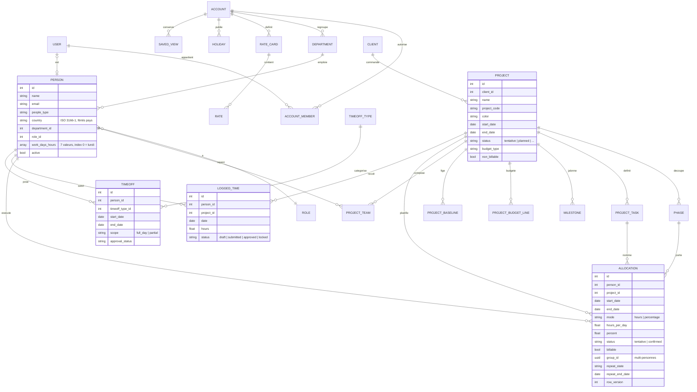
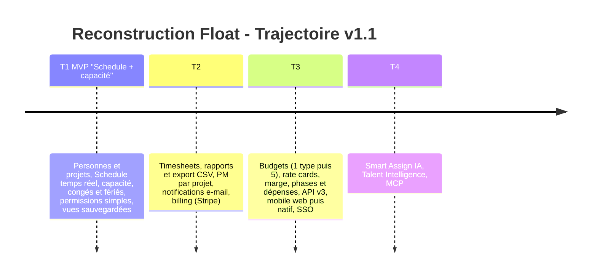

# Reconstruire Float.com — Dossier de fondamentaux produit

**Document compilé par le CPTO** · Synthèse des travaux de l'architecte, de l'UX/UI senior et du PM senior, consolidée après la revue v1.1
Date : octobre 2026 · **Version 1.1** (remplace la v1.0, conservée à l'identique dans `reconstruire-float-com-dossier-de-fondamentaux-produit.md`)

**Documents de référence**

| Document | Rôle |
|---|---|
| `docs/decisions/ADR-001-arbitrage-revue-v1.1.md` | Décisions faisant foi pour la v1.1 (en cas de conflit, l'ADR l'emporte) |
| `schema.sql` (v1.1, baseline `0001_init`) | Modèle de données exécutable ; remplace `schema.sql.txt` (v1.0, archivé). Le dossier ne le recopie pas |
| `docs/review/archi-fonctionnel.md` | Cas limites, BR-18..BR-40, glossaire, matrice BR → tests (TC-xx) |
| `docs/review/archi-solution.md` | Stack, temps réel, multi-tenant, correctifs SQL, ADR techniques, CI |
| `docs/review/product.md` | Epics, critères d'acceptation, périmètre MVP, KPI, risques, GTM |
| `docs/review/ux-ui.md` | Spec écran Schedule, design tokens, accessibilité, wireframes |
| `docs/factory/strategy.md` | Stratégie « dark factory » : phases de production, agents, garde-fous |

> Lecture : les sections 0 à 6 gardent la structure de la v1.0. Les sections 7 et 8 (questions ouvertes, changelog) sont nouvelles. Les identifiants techniques (tables, colonnes, `BR-xx`) restent en anglais.

---

## 0. Executive summary (CPTO)

**Float est le logiciel n°1 de gestion de ressources pour équipes de livraison** (agences créatives, services professionnels, équipes produit internes). Plus de 4 500 équipes l'utilisent, dont Atlassian, Ogilvy, Deloitte, BuzzFeed, KPMG, M&C Saatchi.

**La thèse produit en une phrase :** *le planning de ressources est le système de vérité de la livraison — il connecte les personnes, les projets et l'argent en temps réel, à côté du CRM, de l'outil PM et de la finance, sans les remplacer.*

**Les 5 fondamentaux à reconstruire** (inchangés ; seuls les deux premiers composent le MVP) :

1. **Schedule** — un planning visuel drag-and-drop (personnes × jours) avec code couleur par projet. *MVP.*
2. **Capacity** — disponibilité calculée (heures ouvrées − congés − jours fériés), indicateurs de sur/sous-allocation et alertes de conflit. *MVP.*
3. **Projects & Budgets** — scoping projet (client, phases, tâches, budget, baseline), facturable vs non-facturable vs tentatif. *Projets au MVP ; budgets en T3.*
4. **Time tracking** — timesheets pré-remplies depuis le planning, verrouillables, comparaison planifié vs réel. *T2.*
5. **Reports & Forecast** — utilisation, surtemps, marges, burn budget, forecasts de capacité. *Rapports en T2, marge et forecast en T3.*

**Ce qui change en v1.1.** La revue a montré que le P0 de la v1.0 (FR-01..10) équivalait à ~100 % de la parité Float et contredisait la roadmap §5.5. Le CPTO a donc arbitré (ADR-001) : **MVP réduit « Schedule + capacité »**, promesse testable : *placer quelqu'un sur un projet en moins de 10 s sans surbooker personne, et voir en temps réel la capacité réelle (congés + fériés)*. Le schéma, la convention `work_days_hours`, la définition du siège (BR-15), la stack et 23 règles de gestion nouvelles (BR-18..BR-40) sont fixés dans cette version.

> **ADR-004 : la facturation du produit (plans, tarifs, sièges, essai, Stripe) est exclue.** Le paragraphe suivant est historique.

**Positionnement et modèle économique :** SaaS B2B, tarification *par personne planifiée* (pas par utilisateur actif) — Starter ≈ 7–8 $, Pro ≈ 12–14 $ par personne/mois, Enterprise sur devis (valeurs Float à revérifier avant alignement). Trial de 30 jours, illimité en personnes. B Corp depuis 2024, SOC2 & GDPR. Cap produit actuel de Float : **Talent Intelligence & AI-assisted staffing** (recommandations de staffing, ISO 42001 en cours). La facturation self-serve n'est pas dans le MVP (design partners gratuits, Stripe en T2).

---

## 1. Recherche — Ressources & captures d'écran (CPTO)

*Section inchangée par rapport à la v1.0, sauf mention ci-dessous.*

### 1.1 Sources officielles (produit, pricing, vision)

| Ressource | URL | Ce qu'on y trouve |
|---|---|---|
| Page d'accueil Float | https://www.float.com/ | Positionnement, 3 piliers (People / Projects / Performance), témoignages clients |
| Resource Scheduling (produit) | https://www.float.com/product/scheduling | Le cœur : Schedule, code couleur, tags, vues sauvegardées |
| Capacity Planning (produit) | https://www.float.com/product/capacity-planning | Indicateurs d'utilisation, alertes de sur-capacité |
| Time Tracking (produit) | https://www.float.com/product/time-tracking | Timesheets pré-remplies, verrouillage, deadlines & rappels |
| Float x AI / Talent Intelligence | https://www.float.com/ai | Vision AI : recommandations de staffing, conflits, marges |
| Pricing | https://www.float.com/pricing | Plans Starter / Pro / Enterprise, modèle par personne planifiée |
| Help Center | https://support.float.com | Glossaire, rapports, règles de gestion détaillées |
| API v3 | https://developer.float.com | Toutes les entités du modèle de données |
| Blog produit (Medium) | https://medium.com/float-news | Historique des évolutions (ex. refonte Reports) |

### 1.2 Captures d'écran de l'interface (pour reconstituer les fondamentaux)

| Source | URL | Captures disponibles |
|---|---|---|
| Revue détaillée The Digital Project Manager (FR) | https://thedigitalprojectmanager.com/fr/tools/revue-float/ | Screenshots du Schedule, indicateurs de capacité, revue UX complète |
| Revue Productivity Land | https://productivityland.com/float-resource-scheduling-software-review-pricing-and-features/ | Capture du Schedule + vue Reports |
| App Store iOS | https://apps.apple.com/us/app/float-resource-management/id1318992940 | Screenshots mobile (Schedule, timesheets, congés) |
| SelectHub | https://www.selecthub.com/p/resource-management-software/float-com/ | Captures testées : Smart Assign, budgets, code couleur |
| Capterra | https://www.capterra.com/p/136078/Float/reviews/ | Galerie produit + retours UX |
| G2 | https://www.g2.com/products/float-com/reviews | Galerie produit, fonctionnalités par plan |

> Ces captures appartiennent à Float et aux sites de revue : **référence de design et d'ergonomie, pas assets à copier**. La revue produit ajoute un risque juridique/IP explicite : nom, direction artistique (vert fluo) et wording doivent être originaux ; ne pas utiliser « Float » ni la compatibilité API comme argument marketing sans conseil juridique.

### 1.3 Ce que disent les utilisateurs (signal produit)

- **Ce qui est aimé** : interface claire et rapide (« lightning fast »), drag-and-drop, code couleur, indicateurs de capacité en un coup d'œil, « planifier en un clic », raccourcis clavier, filtres puissants.
- **Points faibles à corriger dans notre rebuild** : reporting avancé limité sans export, learning curve initiale, expérience mobile parfois bancale (popups non fermables), intégrations natives limitées.
- **Impacts clients documentés** : +50 % d'efficacité de resourcing, livraison à l'heure passée de 40 % à 90 %, +33 % d'heures loggées en 6 mois.
- **Réponse produit aux faiblesses** (revue produit §5) : export CSV/Excel sur tous les plans dès T2 ; rapports réconciliables avec le Schedule ; règle « tout popup a un bouton fermer » en critère d'acceptation ; mode compact + import guidé à l'onboarding ; calendriers Google/Outlook avant Jira/Asana.

---

## 2. Le produit décortiqué — modules fondamentaux

| Module | Rôle | Éléments clés | Tranche |
|---|---|---|---|
| **Schedule** | Planning visuel ressources | Vue personnes × jours/semaines/mois, blocs d'allocation, drag-and-drop **et alternative clavier**, code couleur par projet, tags, filtres, vues sauvegardées, recherche, raccourcis clavier | MVP (T1) |
| **People & Capacity** | Disponibilité réelle | Jours et heures ouvrés par personne, congés, jours fériés (par pays/équipe), placeholders, départements, rôles, tags, indicateurs sur/sous-allocation | MVP (T1) |
| **Projects** | Scoping & budgets | Client, statut tentatif/confirmé, couleur, dates au MVP ; phases, tâches, milestones, budget (5 types), baseline, taux de coût et de facturation ensuite | MVP : socle ; T3 : budgets |
| **Time tracking** | Réel vs planifié | Timesheets pré-remplies depuis les allocations, timer optionnel, notes, verrou après soumission, deadlines & rappels | T2 |
| **Reports** | Pilotage | Rapports People (capacité, planifié/loggé, congés, surtemps, % d'utilisation), Projects (burn, planifié vs réel, marge), export CSV/Excel | T2 (base), T3 (marge) |
| **Integrations** | Écosystème | Slack, Jira, Asana, Trello, Google Calendar, Outlook, Zapier, API REST v3, MCP, webhooks/CSV | T3+ |
| **Mobile** | Accès terrain | Schedule en lecture, log de temps en quelques taps, demandes de congés, alertes | T3 (web responsive d'abord, pas d'app native avant) |

---

## 3. Architecte — Modèle de données

> Source primaire : la documentation de l'API v3 de Float (https://developer.float.com/api_reference.html), qui expose les entités du produit : Accounts, Departments, People, Roles, Statuses, Time Off, Time Off Types, Public Holidays, Team Holidays, Clients, Projects, Phases, Project Stages, Project Tasks, Project Expenses, Currencies, Rate Cards, Milestones, Allocations (Tasks), Logged Time, Delete Log, Reports. **La compatibilité champ par champ avec la v3 reste à vérifier** (aucune vérification faite à ce jour).

> **Source de vérité du modèle : `schema.sql` (v1.1).** Ce dossier décrit l'intention et les entités ; il ne duplique ni les colonnes, ni les contraintes, ni les fonctions SQL. En cas d'écart, le schéma et l'ADR priment.

### 3.1 Diagramme entité-relations (vue conceptuelle, mise à jour v1.1)

Écarts avec le diagramme v1.0 : `ACCOUNT_MEMBER`/`USER` (identité et permissions), `people.country`, `allocations.group_id` et `row_version`, `PROJECT_BUDGET_LINE` et `PROJECT_BASELINE` (modélisés, livrés en T3), `SAVED_VIEW`, suppression du doublon `projects.tentative` (BR-20). Les entités d'historisation à effet daté (BR-19), le `change_log` (outbox temps réel), les tokens d'API et les notifications ne sont **pas** dans la baseline `0001_init` (liste « ouvert » en pied de `schema.sql`).

### 3.2 Définition des entités (spécification)

**ACCOUNT** (tenant) — l'entreprise. Fuseau (`timezone`), devise, plan, `week_start` (ISO 1 = lundi .. 7 = dimanche, **affichage seulement**), heures par défaut, réglages de rapport.

**USER / ACCOUNT_MEMBER** *(nouveau)* — une *personne planifiée* (siège) n'est pas un *utilisateur* (compte de connexion). Un rôle (`owner`, `admin`, `project_manager`, `member`, `guest`) est porté par `account_members` ; `people.user_id` est nullable (placeholders, personnes sans accès). Les Guests sont des utilisateurs sans personne.

**DEPARTMENT** — équipe (Design, Dev, Stratégie…). Regroupement du planning et des rapports ; portée possible d'un jour férié d'équipe (BR-30).

**PERSON** — ressource planifiable. Trois `people_type` : `employee`, `contractor`, `placeholder`. Champs essentiels : rôle, département, `country` (pays, jours fériés), tags de compétences, avatar, e-mail, `active`, et `work_days_hours` :

- **Convention (ADR-001 décisions 3 et 4)** : tableau de **7 éléments, stockage ISO, index 0 = lundi** (position 1 du tableau PostgreSQL = lundi = `ISODOW` 1). L'affichage suit `accounts.week_start` ; la conversion éventuelle vers l'API v3, si Float est dimanche-first (à vérifier dans la doc v3), se fait **uniquement** à la frontière de l'adaptateur API. Côté application (tableaux JS 0-based, `Date.getDay()` dimanche = 0), le décalage est un piège à couvrir par tests avec un tableau asymétrique.
- **Défaut corrigé : `{8,8,8,8,8,0,0}`** (lundi à vendredi, 8 h). Le défaut v1.0 `{0,8,8,8,8,8,0}` était dimanche-first et faux.
- **Exemple corrigé** : `[4,4,4,0,0,0,0]` = 4 h du lundi au mercredi. L'exemple v1.0 `[0,4,4,4,0,0,0]` désignait en réalité mardi à jeudi dans la convention index 0 = lundi.
- Contrainte de base : 7 valeurs non nulles comprises entre 0 et 24.

*Règle (BR-15, amendée) : toute personne présente sur le Schedule — employé, contractor ou placeholder — est un siège payant, avec ou sans accès au produit.* **Exclue par l'ADR-004 : aucun siège payant, aucune facturation.**

**ROLE** — fonction (Designer Senior, Dev, PM…). Rapports People (regroupement par rôle) et rate cards.

**RATE_CARD + RATE** — grilles tarifaires par rôle ou personne : coût et facturation, par devise et période. Calcul de marge (T3). Résolution des taux : BR-23.

**CLIENT** — donneur d'ordre : `name`, `short_name`, contacts, tags.

**PROJECT** — unité de travail commerciale : `client_id`, `name`, `project_code` (unique par compte), `color` (code couleur du planning), dates, `project_manager_id` (via `project_managers`), statut (tentatif / planifié / en cours / en pause / terminé / archivé), `non_billable`, tags, notes. `project_team` pré-affecte une équipe. Le caractère tentatif a **une source unique** : `status = 'tentative'` (BR-20). Le budget est modélisé en lignes (`project_budget_lines`) et baselines versionnées (`project_baselines`) : BR-22, livré en T3.

**PHASE** — découpage d'un projet. Dates, statut, couleur, `non_billable` propres.

**PROJECT_TASK** — catégorie de travail nommée (« Design », « Concepting »). Nomme les allocations et pré-remplit le log de temps. Attention au vocabulaire : « task » désigne l'allocation dans l'API v3 de Float mais la catégorie de travail dans notre modèle (voir glossaire de la revue archi fonctionnelle).

**MILESTONE** — jalon daté au niveau projet ou phase.

**ALLOCATION** (appelée *task* dans l'API v3) — **entité pivot du produit** : *qui* (une personne par ligne ; le multi-personnes de la v3 est éclaté en N lignes liées par `group_id`, BR-26), *sur quoi* (projet, phase, tâche optionnelles), *quand* (`start_date`/`end_date`, dates calendaires du fuseau du compte, BR-18), *combien* (mode `hours` ou `percentage`, exclusifs), `status` (tentative/confirmée), `billable`, répétition bornée (BR-25), audit. C'est le bloc visualisé dans le Schedule. Le pourcentage peut dépasser 100 % (BR-01 : la sur-allocation n'est jamais bloquée ; plafond technique à 500 % dans le schéma).

**LOGGED_TIME** — temps réel saisi. Statuts `draft` → `submitted` (verrouillé, BR-12) → `approved` ; `locked` = clôture par échéance. Pas d'entité *timesheet* ni de `allocation_id` dans la baseline : cycle de vie et granularité à trancher avant T2 (BR-28, Q-06). Placeholders exclus de la saisie (BR-27). `ON DELETE RESTRICT` : une donnée de facturation s'archive, elle ne se supprime pas (BR-31).

**TIMEOFF + TIMEOFF_TYPE** — congés (vacances, maladie, formation…). `scope` `full_day` ou `partial`, workflow `pending`/`approved`/`declined`, `deducted` sur le type décide de l'effet sur la capacité. Cycle de vie : BR-29.

**HOLIDAY** — jours fériés à portée compte, pays ou département/équipe, demi-journée possible (BR-30), déduits de la capacité.

**SAVED_VIEW** — vue sauvegardée (filtres, regroupement, zoom, densité, fenêtre relative), personnelle puis partagée (FR-10).

**Entités transverses :** `STATUS`, `PROJECT_EXPENSE`, `CURRENCY`, `DELETE_LOG` (stream des suppressions pour les syncs externes — design d'API moderne à conserver), permissions (Owner, Admin, Project Manager, Member, Guest, BR-33). Les entités du dossier non encore modélisées (`STATUS` personnalisés, `CURRENCY`, notifications, référentiel de compétences et séniorité pour FR-17) sont au backlog du schéma.

### 3.3 Choix d'architecture retenus (ADR-001, décision 9)

| Couche | Choix | Remarque |
|---|---|---|
| Langage | **TypeScript** partout, monorepo (pnpm + Turborepo) | Types partagés, moteur de règles `@app/rules` réutilisé client/serveur |
| Front | React + Vite ; Schedule : **moteur de layout TypeScript + blocs DOM virtualisés** (ADR-002, amende ADR-001 n°9 « canvas + overlay DOM ») | Spike DOM vs canvas avant P1 ; canvas en repli |
| API | **Fastify** + Zod → OpenAPI généré (contrat) | API v3 via un adaptateur distinct du domaine |
| Accès base | **Kysely**, SQL-first, migrations SQL pures | Pas d'ORM qui masque RLS/contraintes |
| Base | **PostgreSQL ≥ 15** | `NULLS NOT DISTINCT`, `ON DELETE SET NULL (col)`, vues `security_invoker` |
| Temps réel | **WebSocket + outbox `change_log`** | Écriture métier et événement dans la même transaction ; rattrapage par `seq` à la reconnexion |
| Multi-tenant | `account_id` partout, **RLS** `FORCE`, FK composites `(id, account_id)` | `SET LOCAL app.account_id` à chaque transaction ; BR-32 |
| Jobs / cache | pg-boss, Redis (fan-out WS, cache préfixé par tenant) | Recommandation archi-solution, non reprise dans l'ADR |

Détails, budgets de latence, risques et ADR techniques : `docs/review/archi-solution.md` (§1 et §3.2). Règles structurantes retenues :

- **Capacité calculée, jamais stockée.** `capacité brute = work_days_hours[jour]` ; `disponibilité (capacité nette) = capacité brute − congés déduits − jours fériés` ; le Schedule affiche `Σ allocations vs disponibilité` par jour. Implémentation de référence en TypeScript pur (`@app/rules`) pour l'optimisme UI < 100 ms, fonctions SQL pour les rapports, **parité testée**. Les fonctions `daily_planned_load`, `daily_capacity` et `utilization` ont été **réécrites** (les versions v1.0 étaient fausses : intervalles en secondes, répétitions, jours non ouvrés), avec un jeu de tests SQL de non-régression (`tests/sql/`) à écrire d'abord (ADR décision 5). La vue `v_utilization` est supprimée au profit de fonctions paramétrées `(account_id, from, to)`.
- **Temps réel.** Toute mutation d'allocation, de congé ou de projet se propage en < 1 s (p95) à tous les clients ; ack de mutation p95 < 150 ms. Contrôle optimiste par `row_version` (409), id de mutation client pour dédoublonner l'écho. **Le filtrage d'autorisation s'applique aussi à la diffusion WebSocket** (un Member ne reçoit que ses assignations).
- **Performances.** Matrice creuse personnes × jours ; rendu virtualisé sur deux axes pour 300+ personnes × 12 mois ; chargement par fenêtre (`/schedule?from&to`) ; budget de perf en CI.
- **Auditabilité et suppression.** `created_by/modified_by/created_at/modified_at/row_version` sur toute entité mutable ; **BR-14 portée par la base** : triggers `delete_log` y compris sur cascades (ADR décision 7). Verrouillage des logs (BR-12) par trigger. Le retrait d'équipe (BR-10) reste une opération applicative atomique « récapitulatif → confirmation → suppression » appuyée sur `team_removal_summary()`.
- **Intégrité.** Pas d'exclusion de chevauchement sur `allocations` (BR-01) ; `ON DELETE RESTRICT` sur `logged_time` ; aucune cascade ne supprime d'allocation sur congé (BR-04).

---

## 4. UX/UI Senior — Ergonomie ultra-fluide & DA

Spec détaillée (structure de l'écran, états de capacité, tokens, composants, mobile, accessibilité, wireframes) : `docs/review/ux-ui.md`. Cette section ne conserve que les principes et leurs amendements.

### 4.1 Les 8 principes d'ergonomie (amendés v1.1)

1. **Une seule surface de vérité.** Le Schedule est l'écran par défaut ; 5 onglets (Schedule, Projects, People, Time tracking, Reports). *Amendement :* Settings/Account vivent hors navigation principale, et le détail projet s'ouvre dans un panneau latéral (pas un 6e onglet). Au MVP, seuls Schedule, Projects et People sont actifs.
2. **Tout se fait en drag-and-drop — et jamais seulement en drag-and-drop.** Créer, déplacer, étirer (poignées), dupliquer, splitter sans modal ; le clic ouvre un popover. *Amendement (bloquant, WCAG 2.1.1 et 2.5.7) : **chaque geste de drag-and-drop a une alternative clavier et tactile*** — `Alt+Flèches` pour déplacer d'un jour ou d'une ligne, `Shift+Flèches` pour redimensionner, popover avec champs dates/heures, appui long + poignées ≥ 24 px au tactile. La grille est un `role="grid"` à un seul tab-stop (flèches à l'intérieur).
3. **Temps réel et réactivité perçue.** Latence < 100 ms en local (optimistic UI), sync live sans refresh, indicateur discret « synchronisé / en cours ». Rollback animé avec « Réessayer » en cas d'échec ; en cas de conflit, la dernière écriture gagne avec notification (stratégie définitive : question ouverte Q-02). Animations désactivées sous `prefers-reduced-motion`.
4. **L'information en un coup d'œil.** Code couleur par projet, motif pour le tentatif, barre de capacité, congés en blocs distincts. Surbooking **non intrusif mais identifiable** (bordure, hachures, compteur — pas de modal). *Amendement :* aucune information portée par la couleur seule (WCAG 1.4.1) ; la palette projet exclut les teintes sémantiques de capacité (pas de rouge projet).
5. **Zéro friction de saisie.** Timesheets pré-remplies (« Yep, that's what I did »), raccourcis pour tout, recherche instantanée, filtres combinables, **vues sauvegardées**, état du Schedule dans l'URL.
6. **Progressivité.** Simple par défaut, puissant en option. *Amendement :* mode compact (lignes 32 px, champs avancés masqués), création de projet réduite à nom/client/couleur/dates/statut (budget différé), assistant de première allocation (< 5 min).
7. **Mobile = lecture + 3 actions rapides** (planning, log de temps en 2 taps, demande de congé) ; jamais de popup sans bouton fermer (règle de lint du design system). Livré en T3, sous forme de web responsive avant toute app native.
8. **Confiance par l'annulabilité.** *Amendement (portée de l'undo, ADR décision 9) :* **l'undo est une pile locale de session** (≥ 20 actions) couvrant les actions serveur inversibles (créer, déplacer, redimensionner, supprimer) ; il ne constitue pas un historique serveur. Les suppressions en cascade (BR-10) ne sont pas annulables par simple `Ctrl+Z` : confirmation explicite avec récapitulatif obligatoire. Jamais de suppression silencieuse (BR-04, BR-10).

### 4.2 Parcours fondamentaux à fluidifier en priorité

**North star UX :** « placer le bon talent sur le bon projet en moins de 10 secondes, avec la certitude de ne surbooker personne » (à instrumenter : temps entre ouverture du Schedule et allocation posée).

Parcours à ajouter à la conception (absents de la v1.0) : première allocation d'un compte vide (assistant 3 étapes, bloquant), résolution d'un surbooking depuis l'alerte avec bouton « Trouver quelqu'un de dispo » (bloquant), congé sur allocations avec report assisté (BR-04), demande/approbation de congé, retrait d'une personne d'un projet (BR-10), onboarding/import CSV ; déverrouillage de timesheet en T2.

### 4.3 Direction artistique — simple mais efficace

- **Tonalité** : outil professionnel épuré, sans décoration gratuite ; l'effet « wow » vient de la vitesse et de la clarté.
- **Couleurs** : fond neutre clair, texte anthracite, **une couleur d'accent de marque**. *Amendement :* l'accent doit être **distinct de `--cap-ok`** et **conforme AA** (≥ 4,5:1 en texte/bouton, texte sur accent sombre ; le blanc sur vert vif échoue). Le vert fluo de Float est donc exclu ; la décision de marque finale reste ouverte (Q-09 de la section 7, aussi liée au risque IP). Le code couleur est **réservé aux projets** (palette générée en OKLCH, texte de bloc calculé pour ≥ 4,5:1, teintes rouges exclues). Sémantique de capacité par tokens (`--cap-under`, `--cap-ok`, `--cap-warn`, `--cap-over`), jamais détournée. Aucune couleur en dur dans les composants.
- **Typographie** : une famille sans-serif d'interface (type Inter), 3 graisses (400/500/600), chiffres tabulaires pour toute heure.
- **Densité maîtrisée** : lignes ~40 px (32 compact, 48 confortable), ombres quasi absentes, rayons subtils, icônes linéaires. Mode sombre en option, **après stabilisation** (pas dans le premier incrément) ; pas d'inversion mécanique des couleurs.
- **Composants clés** : bloc d'allocation, popover d'édition rapide, jauge de capacité, panneau latéral projet, toasts avec « Annuler », timeline virtualisée avec snap sur les semaines.
- **Accessibilité (WCAG 2.2 AA, exigence MVP)** : contraste texte ≥ 4,5:1 et éléments d'interface ≥ 3:1 en clair et sombre ; indication non chromatique (tentatif : motif + pointillé + icône ; surbooking : icône + « +2 h ») ; focus visible 2 px non masqué par les en-têtes sticky ; annonces `aria-live` pour sauvegarde, rollback, mises à jour temps réel ; vue Liste/Table du Schedule comme alternative lecteur d'écran ; axe-core en CI.
- **Seuils d'état de capacité** (sous-allocation < 80 %, OK 80–100 %, limite 100 %, sur > 100 %) : proposition de la revue UX, **non arbitrée** (question ouverte Q-03).

---

## 5. PM Senior — Requirements fonctionnels, règles de gestion & vision

### 5.1 Vision produit

- **Problème** : les équipes de livraison pilotent leurs ressources dans des tableurs isolés qui ne montrent pas l'impact d'un changement de staffing sur le reste, ni le coût, ni la marge — et le vrai planning est toujours périmé.
- **Cible** : PMO, resource managers, ops et finance des agences et équipes internes. *Amendement (revue produit) :* ICP de lancement unique = **agences de 20 à 100 personnes** (créa/marketing) planifiant sur tableurs ; le tableur est le concurrent n°1. L'élargissement 10–500 personnes tous secteurs vient après.
- **Promesse** : *« Protéger la marge que vous avez déjà vendue. »* Savoir en permanence qui est dispo, sur quoi, à quel coût, et si la dérive est rattrapable.
- **Différenciation** : (1) la vitesse du planning, (2) la capacité calculée avec congés et fériés intégrés d'emblée et **fiable** (un chiffre faux détruit la confiance), (3) le lien planning → temps réel → marge dans un seul système (T2-T3), (4) le staffing assisté par IA (T4). Corrections de confiance dès T1 : BR-04 (pas de suppression silencieuse), BR-10 (confirmation), audit visible par allocation.
- **Non-goals assumés** : ne pas remplacer le CRM, l'outil de gestion de projet (tâches/kanban), ni le back-office finance. S'y brancher (API, Zapier, MCP).
- **Séquence** : parité ciblée (vitesse + capacité fiable) → pilotage (marge) → IA.

### 5.2 Requirements fonctionnels — backlog réaligné sur la roadmap (ADR décision 1)

Le « P0 = MVP » de la v1.0 est remplacé par un MVP réduit. Les priorités FR (P0/P1/P2) deviennent des **tranches de roadmap T1..T4** (§5.5). Ne pas les confondre avec les phases de production P0..P5 de `docs/factory/strategy.md`.

| FR | Intitulé | Tranche v1.1 | Précision |
|---|---|---|---|
| FR-01 | Personnes (3 types), rôles, départements, tags | **T1 MVP** | Import CSV simple ; import avancé ensuite |
| FR-02 | Clients et projets (code, couleur, dates, statut, facturabilité) | **T1 MVP** | Sans budget |
| FR-03 | Schedule : vues jour/semaine/mois, h/jour ou %, répétitions, multi-personne, drag-drop-copy | **T1 MVP** | Répétitions daily/weekly d'abord ; mensuelles et multi-personnes avancées ensuite. ADR-002 : zoom jour/semaine/mois à point central conservé ; défilement horizontal sur toute la plage avec bouton « Aujourd'hui » (`T`) ; blocs multi-jours à hauteur = % de capacité, empilés, déplaçables et redimensionnables ; saisie rapide au clavier |
| NFR-i18n | Internationalisation dès le départ | **T1 MVP** | FR et EN au lancement, messages ICU, `Intl` pour dates/nombres/durées, aucune chaîne en dur (lint + pseudo-localisation en CI) ; `accounts.default_locale`, `users.locale` |
| NFR-fluidité | Sensation de fluidité dans la saisie des plages | **T1 MVP** | Manipulation directe, optimistic UI, création perçue < 100 ms, 60 images/s au drag, INP p95 < 100 ms (cibles à mesurer au spike) |
| FR-04 | Indicateurs de capacité, alertes de conflit et de surbooking | **T1 MVP** | |
| FR-05 | Congés et fériés, déduction automatique, workflow de demande | **T1 MVP** | Workflow simple : approuvé / refusé |
| FR-09 | Permissions Owner/Admin/PM/Member/Guest | **T1 simplifié, T2 complet** | MVP : Owner, Admin, Member, Guest ; PM par projet en T2 |
| FR-10 | Recherche, filtres, vues sauvegardées, notifications | **T1 partiel** | Recherche, filtres, vues personnelles, notifications in-app ; e-mail et digest en T2 |
| FR-07 | Time tracking (timesheets pré-remplies, soumission, verrou) | T2 | |
| FR-08 | Rapports People/Projects, export CSV/Excel | T2 | Export sur tous les plans |
| FR-06 | Budgets (5 types) avec baseline | T3 | Livrer d'abord 1 type (heures par projet) |
| FR-11 | Phases, milestones, tâches projet, dépenses | T3 | |
| FR-12 | Rate cards multi-devises, marge temps réel | T3 | Prérequis de la marge (BR-09) |
| FR-13 | Forecast de capacité (demande tentative vs capacité future, hiring plan) | T3 | Demande pondérée par probabilité : champ à définir |
| FR-14 | Mobile (lecture, log temps, congés, alertes) | T3 | Web responsive avant app native |
| FR-15 | API publique v3, delete log stream, intégrations | T3 | Calendriers Google/Outlook avant Jira/Asana |
| FR-16 | Baseline estimate vs scope courant | T3 | |
| FR-17 | Smart Assign | T4 | Exige compétences structurées (niveau, séniorité) |
| FR-18 | Talent Intelligence | T4 | V1 mesurable : sur-allocation prévisible à 4 semaines, alerte marge |
| FR-19 | MCP / langage naturel | T4 | |

**Hors MVP, explicitement :** timesheets, rapports, budgets/rate cards, mobile natif, API v3, SSO, billing (Stripe en T2 ; design partners gratuits), ISO 42001, Zapier/Slack/Jira.

### 5.3 Epics et critères d'acceptation du MVP

Format Given/When/Then abrégé ; **chaque critère devient un test automatisé** (source : `docs/review/product.md` §1).

**E1 — Organisation & personnes (FR-01)**
- US-1.1 Création d'une personne (employee/contractor/placeholder). CA : moins de 3 champs obligatoires (nom, type, horaires par défaut du compte) ; `work_days_hours` accepte 7 valeurs de 0 à 24 ; un placeholder n'exige pas d'e-mail ; l'archivage (`active=false`) conserve l'historique et retire la personne du Schedule par défaut.
- US-1.2 Import CSV de personnes/projets/clients (time-to-value < 1 jour). CA : 300 lignes importées en < 30 s ; rapport d'erreurs ligne par ligne ; ré-import idempotent (clé e-mail / `project_code`).

**E2 — Clients & projets (FR-02)**
- US-2.1 Création client et projet. CA : `project_code` dupliqué rejeté avec message clair ; couleur proposée à contraste ≥ 4,5:1 sur fond clair et sombre ; `end_date < start_date` rejeté.
- US-2.2 Retrait d'une personne de l'équipe projet (BR-10). CA : modal récapitulatif « N allocations, M heures loggées seront supprimées » ; rien n'est supprimé sans confirmation ; une entrée `delete_log` par suppression ; toast « Annuler » 10 s.

**E3 — Schedule (FR-03), cœur de valeur**
- US-3.1 Créer une allocation par drag sur une cellule. CA : création < 100 ms perçue ; refusée sur jour non ouvré (BR-01) mais acceptée au-delà de la capacité ; le mode % calcule `percent × work_days_hours[jour]`.
- US-3.2 Déplacer, étirer, dupliquer, splitter, supprimer (+ undo/redo). CA : `Ctrl+Z` annule la dernière action, suppression comprise ; le split conserve projet/tâche/notes ; la copie multi-personnes crée N allocations ; **chaque geste a son équivalent clavier** (§4.1).
- US-3.3 Multi-personnes et répétition. CA : « cette occurrence » vs « toute la série » proposé ; `repeat_end_date` obligatoire si répétition.
- US-3.4 Vues jour/semaine/mois. CA : 300 personnes × 12 mois, premier rendu < 2 s, défilement ≥ 50 fps (poste de référence défini).
- US-3.5 Temps réel multi-client. CA : mutation visible chez un 2e client en < 1 s (p95) ; conflit d'édition concurrent : pas de perte silencieuse, notification.

**E4 — Capacité & alertes (FR-04, BR-01..03)**
- US-4.1 Indicateur par personne/jour et barre de capacité. CA (jeu chiffré) : 8 h ouvrées, 1 férié, 4 h de congé, 5 h allouées → capacité 4, utilisation 125 %, surtemps 1 h ; état exposé aussi par motif/icône. *Le jeu de test devra être revalidé avec les définitions BR-38 (sur-allocation planifiée vs surtemps réel).*
- US-4.2 Agrégats par équipe/département/semaine.

**E5 — Congés & fériés (FR-05, BR-02/04/05)**
- US-5.1 Demande, approbation, refus ; types configurables ; demi-journées. CA : un congé `pending` s'affiche hachuré ; effet sur la capacité tant que `pending` : règle à trancher (le schéma déduit tout sauf `declined`, BR-29 propose de déduire sans déclencher l'assistant avant approbation).
- US-5.2 Congé pleine journée sur jour alloué (BR-04). CA : aucune allocation supprimée ; avertissement listant les allocations impactées ; actions « reporter / laisser / réduire » ; badge de conflit tant que non résolu ; temps loggé jamais modifié.
- US-5.3 Fériés par pays (+ équipe). CA : une personne rattachée à FR ne voit pas les fériés US (repose sur `people.country`).

**E6 — Permissions & sécurité (FR-09)**
- US-6.1 Rôles Owner/Admin/Member/Guest (PM par projet en T2). CA : un Member ne voit que ses assignations, **API et WebSocket incluses** ; un Guest n'a aucune écriture ; matrice de droits testée endpoint par endpoint ; isolation multi-tenant testée (aucune fuite inter-compte).

**E7 — Recherche, filtres, vues sauvegardées, notifications (FR-10)**
- US-7.1 Filtres combinables (tags, département, projet, client) + recherche instantanée (< 150 ms).
- US-7.2 Vues sauvegardées personnelles (partagées ensuite).
- US-7.3 Notifications in-app au MVP (e-mail et digest quotidien en T2, désabonnement par type).

**Epics hors MVP** (critères dans `docs/review/product.md`) : E8 timesheet (T2), E9 rapports (T2), E10 budgets (T3), E11..E19 (T3-T4).

### 5.4 Règles de gestion (business rules)

Les BR-01..BR-17 sont conservées ; les formulations amendées par l'ADR sont signalées. Les cas limites détaillés (E-xx, T-xx, B-xx, L-xx, P-xx, Z-xx, R-xx, H-xx) et la matrice BR → cas de test (TC-xx) sont dans `docs/review/archi-fonctionnel.md` §2 et §5.

**Capacité & planning**
- BR-01 : Capacité journalière d'une personne = `work_days_hours[jour]` ; une allocation ne peut être *posée* que sur un jour ouvré, mais peut **dépasser** la capacité (sur-allocation signalée, jamais bloquée). *Pourcentage non plafonné à 100 % (BR-24). Autoriser ou non la pose sur jour non ouvré reste à confirmer (Q-11).*
- BR-02 : Disponibilité = capacité − heures de congés approuvés ou posés − heures de jours fériés applicables (pays + équipe).
- BR-03 : Surtemps = heures allouées au-delà de la capacité ; visible sur le Schedule et agrégé dans les rapports People. *Distinction planifié/réel : voir BR-38.*
- BR-04 : Un congé **pleine journée** posé sur un jour contenant des allocations ou du temps loggé **ne supprime rien** (déviation volontaire de Float, validée par l'ADR et le schéma : aucune cascade ni trigger) : avertissement listant les impacts et report assisté (reporter / réduire / garder).
- BR-05 : Les congés d'un membre n'impactent que sa ligne ; une allocation multi-personnes reste sur les autres.

**Projets & budgets**
- BR-06 : Un projet ou une phase `non_billable` ne compte jamais dans le taux d'utilisation facturable. *Reformulé : `non_billable` est porté par `projects`/`phases`, pas par `clients` ; précédence en BR-21.*
- BR-07 : Les heures d'un projet tentatif sont comptabilisées séparément (budget de pipeline) et n'entrent pas dans le report « confirmé » tant que le statut n'est pas confirmé. *Source du tentatif : BR-20.*
- BR-08 : Le budget projet est recalculé en direct à chaque allocation (heures × taux) et comparé à la baseline ; la dérive est affichée dans la barre projet (T3).
- BR-09 : Coût projet = Σ(allocation × taux de coût) ; marge = budget facturable − coût ; au niveau phase et personne (T3 ; taux : BR-23).
- BR-10 : Retirer une personne de l'équipe projet **supprime** ses allocations et temps loggés pour ce projet (règle Float) → confirmation explicite avec récapitulatif des suppressions. *Refusé si des logs verrouillés existent (BR-31).*

**Temps & rapports** *(T2)*
- BR-11 : Timesheet pré-rempli = miroir des allocations confirmées de la période ; l'utilisateur confirme ou ajuste ; heures décimales partout.
- BR-12 : Après soumission (ou échéance), le timesheet est verrouillé ; seuls Admin/Owner déverrouillent, de façon tracée. Garanti par trigger en base.
- BR-13 : Utilisation = heures facturables planifiées ÷ capacité ; le rapport People distingue `planifié % capacité`, `facturable % capacité`, `facturable % planifié` (dénominateurs : BR-38).
- BR-14 : Toute suppression d'entité (allocation, congé, log), cascades comprises, est journalisée dans `delete_log` (72 h de rétention minimum pour les syncs), par trigger.

**Comptes & monétisation**
- BR-15 **EXCLUE (ADR-004 : pas de facturation du produit).** Texte historique : *(amendée, ADR décision 2)* : **Siège facturé = toute personne présente sur le Schedule** — employé, contractor ou **placeholder** — qu'elle ait un accès ou non ; les Guests sont gratuits et hors modèle de personnes. La note d'arbitrage SQL « siège = `work_days_hours` > 0 » est supprimée. Détail de comptage : BR-34.
- BR-16 **EXCLUE (ADR-004).** Texte historique : Projets et clients illimités sur tous les plans ; trial 30 jours à fonctionnalités Pro, données conservées 6 mois après expiration ; rétrogradation = perte des fonctionnalités Pro, données intactes (BR-35).
- BR-17 **EXCLUE (ADR-004).** Texte historique : Les plans se différencient par fonctionnalités (Starter : scheduling, capacité, congés, planning projet, budgets basiques ; Pro : + time tracking, SSO, estimation, rapports avancés ; Enterprise : + contrats custom, placeholders custom, SLA, onboarding dédié), pas par volume de données. *« Placeholders custom » à clarifier (Q-12, section 7).*

**Règles ajoutées en v1.1 (BR-18..BR-40)** — numérotation et libellés de `docs/review/archi-fonctionnel.md` §3. Le tag indique la priorité de la revue ; l'ADR décision 8 met en tête **BR-18, BR-22, BR-23, BR-28, BR-31**. BR-22 et BR-23 sont modélisées dès maintenant mais livrées en T3 (budgets multi-types, baseline versionnée).

| BR | Prio | Règle |
|---|---|---|
| BR-18 | BLOQUANT | **Dates et semaine.** Les dates métier sont des dates calendaires du fuseau du compte (jamais converties). `work_days_hours` est indexé lundi=1..dimanche=7 (ISO). `week_start` n'affecte que l'affichage et les périodes. *(Équivalent de « index 0 = lundi » côté tableau 0-based, position 1 côté PostgreSQL.)* |
| BR-19 | IMPORTANT | **Historisation.** Horaire de travail, taux de coût, rôle et département sont à effet daté ; une modification s'applique à partir d'une date et ne change jamais une période verrouillée. |
| BR-20 | IMPORTANT | **Tentatif.** Source unique : `projects.status = tentative` ou `allocations.status = tentative`. Tentatif effectif = l'un OU l'autre. Une allocation tentative n'alimente ni le préremplissage, ni les rapports « confirmé », ni la facturation ; elle est comptée dans la charge avec une décomposition. |
| BR-21 | IMPORTANT | **Facturabilité.** Précédence : projet > phase > tâche > allocation/log. Un niveau non facturable rend tous les niveaux inférieurs non facturables par défaut ; l'inverse est impossible. |
| BR-22 | BLOQUANT | **Budget.** Définition formelle des 5 types, unité, devise, répartition en lignes (tâche/personne), règle de somme, baseline versionnée, source du burn (planifié et réel), traitement des dépenses. |
| BR-23 | BLOQUANT | **Résolution des taux.** Pour une personne P, un projet J et un jour D : taux de la rate card de J valide à D, ligne personne > ligne rôle ; à défaut taux de coût de la personne ; à défaut « taux manquant » (jamais 0 silencieux). Conversion de devise à la date de D. |
| BR-24 | IMPORTANT | **Pourcentage.** Conversion en heures = % × capacité de référence (à définir, H-01) du jour ; non plafonné à 100 % ; les heures stockées dans un log préremplis sont figées à la création. |
| BR-25 | IMPORTANT | **Répétition.** Une série est bornée (fin ou horizon maximal) ; chaque occurrence = durée de l'allocation de base ; modifications « occurrence / série / à partir d'ici » ; jours non ouvrés ignorés ; mensuel au dernier jour valide. |
| BR-26 | IMPORTANT | **Allocation multi-personnes.** Un groupe partage nom, dates, projet ; chaque membre a ses propres heures ; l'édition propose « tous / celle-ci » ; un congé n'affecte que la ligne concernée (renforce BR-05). |
| BR-27 | IMPORTANT | **Placeholders.** Ne logguent pas de temps ; ont une capacité et un rôle ; remplaçables par une personne réelle (transfert) ; comptés comme sièges (BR-15) ; reportés séparément. |
| BR-28 | BLOQUANT | **Cycle de vie du timesheet.** Période configurable, soumission atomique, échéance → verrouillage automatique, aucune écriture (ajout, modification, suppression) dans une période verrouillée, déverrouillage Admin/Owner journalisé, préremplissage matérialisé avec lien vers l'allocation source, total par personne et par jour ≤ 24 h. |
| BR-29 | IMPORTANT | **Cycle de vie des congés.** `pending` compte dans la capacité, ne déclenche l'assistant BR-04 qu'à l'approbation ; `declined` ou annulé libère la capacité ; congés cumulés plafonnés à la capacité du jour ; un congé ne s'applique qu'aux jours ouvrés. |
| BR-30 | IMPORTANT | **Jours fériés.** Portée : compte, pays de la personne, ou département/équipe ; possibilité de demi-journée ; priorité sur le congé (pas de double déduction). |
| BR-31 | BLOQUANT | **Suppression et désactivation.** Hard-delete interdit pour personnes, projets et logs approuvés/verrouillés (désactivation/archivage à la place) ; toute suppression autorisée, y compris en cascade, écrit dans `delete_log` ; retrait d'équipe (BR-10) refusé si logs verrouillés ; désactiver une personne propose de réaffecter ou supprimer ses allocations futures. |
| BR-32 | IMPORTANT | **Isolation multi-tenant.** Toute relation est intra-compte, garantie en base (FK composites ou RLS) et non seulement par l'application. |
| BR-33 | IMPORTANT | **Permissions.** Matrice Owner/Admin/PM/Member/Guest × entité × action (lecture, création, modification, suppression, verrou/déverrou, voir les taux et la marge). Un Member ne voit pas les taux de coût d'autrui ; un PM est limité à ses projets. Lien utilisateur ⇄ personne. |
| BR-34 | EXCLUE (ADR-004) | IMPORTANT | **Sièges.** Siège = personne non archivée présente sur le Schedule (placeholders inclus) à l'instant de comptage T (à définir : pic mensuel recommandé) ; indépendant de `work_days_hours`. |
| BR-35 | IMPORTANT | **Plans et essai.** Dates d'essai et de conservation stockées ; matrice fonctionnalité × plan appliquée côté serveur ; à la rétrogradation les données du time tracking restent intactes mais en lecture seule. |
| BR-36 | IMPORTANT | **Concurrence et temps réel.** Contrôle optimiste (`version`/`modified_at`) sur les mises à jour ; en cas de conflit, la dernière écriture gagne avec notification ; mutation idempotente (clé de requête) ; propagation < 1 s. |
| BR-37 | CONFORT | **Bornes de dates.** Une allocation hors des dates du projet ou de la phase est acceptée avec avertissement (jamais bloquée) ; une phase hors du projet idem. |
| BR-38 | IMPORTANT | **Indicateurs.** Sur-allocation = planifié > capacité nette (jour, personne). Surtemps = loggé > capacité. Capacité nulle et charge > 0 ⇒ sur-allocation maximale (jamais NULL). Dénominateurs de BR-13 explicites (capacité nette) et division par zéro définie. |
| BR-39 | CONFORT | **RGPD.** Droit à l'effacement vs `delete_log` et logs verrouillés : anonymisation de la personne (nom, e-mail) en conservant les heures. Rétention des données après suppression de compte. |
| BR-40 | CONFORT | **Annulation.** L'annulation (undo) d'une action multi-effets (report assisté, retrait d'équipe) restaure l'état exact ; durée de vie de l'undo définie. **Arbitrage CPTO (ADR-001 §10)** : Ctrl+Z ne rejoue pas les cascades BR-10 ; la suppression en cascade est confirmée avec récapitulatif puis différée de 10 s derrière un toast « Annuler » (aucune écriture destructive avant l'échéance). |

Couverture dans `schema.sql` v1.1 : le schéma référence BR-01..05, 07, 09..15, 18..21, 25..30, 34 et 38 ; restent à implémenter ensuite BR-19 (historisation), BR-22/23 (calcul), BR-24 (le schéma préjuge de Q-04, section 7), BR-33 à BR-37 côté application, et BR-39/40. La couverture réelle fait foi dans le schéma, pas dans cette liste.

### 5.5 KPIs produit

Les cibles de la v1.0 sont conservées, mais l'ADR demande de **redéfinir** les KPI WAU/sièges (activation, North Star, p95 de sync). Propositions de la revue produit, à valider :

| KPI | Cible v1.0 | Amendement v1.1 |
|---|---|---|
| Temps pour créer la 1ʳᵉ allocation après signup | < 5 min | Conservé |
| Adhérence temps loggé / temps planifié | > 90 % | À définir : heures loggées ÷ heures planifiées confirmées, sur timesheets soumis ; séparer l'adhérence de soumission (processus) ; mesurable à partir de T2 |
| Utilisateurs actifs hebdo sur le Schedule | > 80 % des sièges payés | **À redéfinir** : inatteignable tel quel (les sièges incluent des personnes sans accès) ; mesurer sur les utilisateurs avec accès, ajouter « % de sièges ayant un compte actif » |
| Time-to-value (plan complet importé) | < 1 jour | Conservé (import CSV simple au MVP) |
| Churn logo | < 10 %/an | Objectif de maturité ; en phase design partners : utilisation hebdomadaire de 5 comptes pilotes |
| NPS | > 50 | Conservé |
| *Nouveau* — Activation | — | Compte avec ≥ 5 personnes, ≥ 3 projets, ≥ 20 allocations à J7 |
| *Nouveau* — North Star | — | Allocations confirmées / semaine / compte (proposition) |
| *Nouveau* — Santé technique | — | p95 drag-to-render, p95 de propagation temps réel, erreurs de sync, taux de conflits résolus |

### 5.6 Roadmap réalignée (ADR décision 1)

Production du MVP : la stratégie « dark factory » (`docs/factory/strategy.md`) découpe le MVP en phases P0 Fondations → P5 Durcissement, avec un gate humain par phase, des tests comme juge et un budget indicatif de ~ 420 M tokens. Ce dossier n'en reprend pas le détail.

---

## 6. Décisions CPTO & prochaines étapes

1. **Priorité absolue inchangée** : le Schedule temps réel avec indicateurs de capacité — c'est 80 % de la valeur perçue. Le MVP se limite à cela, plus ce qui le rend crédible (congés, fériés, permissions simples, vues).
2. **Parité fonctionnelle ciblée d'abord, différenciation ensuite** : Schedule et capacité irréprochables avant tout autre terrain (T1), pilotage par la marge (T2-T3), IA de staffing en T4 conditionnée par des données de compétences structurées.
3. **Décisions de l'ADR-001 (résumé)** : (1) MVP réduit ; (2) BR-15 = toute personne sur le Schedule ; (3) stockage ISO de `work_days_hours` ; (4) défaut `{8,8,8,8,8,0,0}` — le SQL était cohérent, c'est le défaut v1.0 qui était faux ; (5) réécriture des fonctions SQL avec tests d'abord ; (6) intégrité et sécurité bloquantes (`account_id` partout, FK composites, RLS, `users`/`account_members`, `ON DELETE RESTRICT` sur `logged_time`, pas d'exclusion de chevauchement) ; (7) BR-10/12/14 portées par la base ; (8) BR-18..BR-40 adoptées ; (9) UX et stack. Le texte de l'ADR fait foi.
4. **Chantiers**. Les cinq chantiers ouverts de la v1.0 évoluent : (a) schéma SQL — **fait** en v1.1 (`schema.sql`) ; (b) design system — tokens validés (accent AA distinct de `--cap-ok`) avant la phase UI ; (c) prototype du Schedule (virtualisation + optimistic UI + alternative clavier) — en tête de la phase UI ; (d) matrice de test des règles de gestion — amorcée (TC-xx de la revue, jeu de tests SQL dans `tests/sql/`) ; (e) audit des captures §1.2 — inchangé. Nouveau : (f) stratégie dark factory (`docs/factory/strategy.md`), proposition à valider par le CPTO.
5. **Pré-requis avant code applicatif** : réponses aux questions ouvertes « avant P1 » (section 7), jeu de tests SQL de non-régression relu par un humain, vérification de la convention de jours de l'API v3.
6. **Risques** (revue produit et solution) : scope creep de la parité ; performance de la matrice à 300+ personnes (prototype d'abord) ; fiabilité du calcul de capacité (tests dorés) ; fuite multi-tenant, y compris par WebSocket ; concurrence d'un leader installé ; risque IP (nom, DA, wording originaux) ; conformité attendue en B2B (DPA, hébergement UE, journal d'audit dès le MVP) ; mauvaise utilisation de l'IA en T4 (explicabilité, validation humaine).

---

## 7. Questions ouvertes

### 7.1 Questions de l'ADR-001 (à traiter avant la phase concernée)

| # | Question | À traiter avant | Éléments de la revue |
|---|---|---|---|
| Q-01 | **Heures tentatives dans la charge** : comptent-elles dans la sur-allocation et l'utilisation, ou seulement dans une vue « demande/pipeline » ? | P1 factory / avant T2 pour l'utilisation | Proposition : oui dans la charge avec décomposition confirmé + tentatif, non dans la facturation (archi fonctionnel T-04) |
| Q-02 | **Stratégie de conflit temps réel** : dernière écriture gagne par bloc, ou verrouillage optimiste avec écran de résolution ? | P1 (avant l'API temps réel) | BR-36 et la revue solution proposent `row_version` + 409 ; UX propose LWW + toast |
| Q-03 | **Seuils de capacité** sous/sur-allocation (sous < 80 %, OK 80–100 %, limite, sur > 100 % ?) et paramétrage par compte | P1 | Revue UX §2.5 et §6 |
| Q-04 | **Base du pourcentage** : capacité brute ou nette ? | Avant T2 | Proposition : brute pour l'affichage, nette pour l'alerte (H-01). Attention : `schema.sql` calcule déjà le % sur les heures ouvrées brutes, ce qui préjuge de la réponse |
| Q-05 | **Granularité et verrou des timesheets** (jour/semaine/période, échéance automatique, état `approved` vs `locked`) | Avant T2 | BR-28, L-01, L-02, L-07 |
| Q-06 | **Pays et jours fériés d'équipe** | Résolu pour la baseline | `people.country` et `holidays.department_id` sont inclus dans `schema.sql` v1.1 |
| Q-07 | **KPI WAU/sièges** : activation, North Star, p95 de sync | Avant le premier jalon de mesure | §5.5 |

### 7.2 Questions issues des revues, non tranchées par l'ADR (à reprendre dans l'ordre de besoin)

| # | Question | Source |
|---|---|---|
| Q-08 | Un congé `pending` réduit-il la capacité et déclenche-t-il l'avertissement BR-04 ? (BR-29 propose : réduit, sans assistant avant approbation) | archi fonctionnel Q-03, produit Q4 |
| Q-09 | Couleur d'accent de marque et identité visuelle distincte de Float (impact IP et `--cap-ok`) | UX Q6, produit Q10 |
| Q-10 | Instant de comptage des sièges (pic mensuel, quotidien, fin de mois ?) ; traitement d'une personne archivée | archi fonctionnel Q-10, BR-34 |
| Q-11 | Pose sur jour non ouvré (BR-01) : refuser, avertir ou autoriser ? | archi fonctionnel Q-12, UX Q7 |
| Q-12 | « Placeholders custom » (BR-17 Enterprise) alors que les placeholders sont dans le MVP pour tous | archi fonctionnel Q-09 |
| Q-13 | Définition des 5 types de budget et source du burn (planifié/réel) ; multi-devises vs devise unique | archi fonctionnel Q-05, Q-11 (avant T3) |
| Q-14 | Retrait d'équipe vs logs verrouillés ; allocation exigeant l'appartenance à `project_team` | archi fonctionnel Q-07 |
| Q-15 | Compatibilité avec l'API v3 de Float (convention de jours, CGU, argument d'adoption) | solution B2, produit Q9 |
| Q-16 | Marché et langues de lancement (FR seul ou FR/EN), hébergement UE, début de semaine configurable | produit Q7, UX Q11 |
| Q-17 | Rétention de `delete_log` au-delà de 72 h (RGPD/SOC2) ; rétention des 6 mois post-trial | archi fonctionnel Q-18, produit |

---

## 8. Changelog v1.0 → v1.1

| Section | Changement | Source |
|---|---|---|
| En-tête | Version 1.1 ; liste des documents de référence ; l'ADR prime sur le dossier ; le schéma est la source de vérité du modèle | ADR |
| §0 | MVP réduit « Schedule + capacité » ; promesse testable ; fondamentaux marqués par tranche ; billing hors MVP | ADR 1, produit §2 |
| §1.2-1.3 | Risque IP explicite ; réponses produit aux faiblesses de Float | produit §3, §5 |
| §2 | Colonne « Tranche » par module ; mobile web d'abord | ADR 1, produit |
| §3 intro, §3.1 | Renvoi à `schema.sql` ; ER mis à jour (`USER`, `ACCOUNT_MEMBER`, `country`, `group_id`, budgets en lignes, `SAVED_VIEW`) ; `v_utilization` supprimée au profit de fonctions paramétrées | ADR 5, 6 ; solution |
| §3.2 PERSON | **Convention `work_days_hours`** : stockage ISO index 0 = lundi ; défaut `{8,8,8,8,8,0,0}` ; **exemple corrigé** `[4,4,4,0,0,0,0]` (v1.0 : `[0,4,4,4,0,0,0]`) ; contrainte 7 valeurs | ADR 3, 4 |
| §3.2 | Nouvelles entités : `USER`, `ACCOUNT_MEMBER`, `SAVED_VIEW`, `PROJECT_BUDGET_LINE`, `PROJECT_BASELINE` ; tentatif à source unique ; `ON DELETE RESTRICT` sur logs | ADR 6, 7 ; BR-20, BR-31 |
| §3.3 | Stack arrêtée : TypeScript monorepo, Fastify, Kysely, PostgreSQL ≥ 15, WebSocket + outbox `change_log`, canvas + overlay DOM ; RLS et FK composites ; fonctions SQL réécrites avec tests d'abord ; BR-10/12/14 par la base | ADR 5-7, 9 |
| §4.1 | Principe 2 : alternative clavier/tactile à chaque drag-and-drop ; principe 8 : portée de l'undo (pile locale de session), cascades non annulables par `Ctrl+Z` ; principes 1, 4, 6 précisés | ADR 9, UX |
| §4.2-4.3 | Parcours ajoutés ; accent de marque AA distinct de `--cap-ok` ; mode sombre différé ; exigence WCAG 2.2 AA au MVP | ADR 9, UX |
| §5.1 | ICP de lancement : agences de 20 à 100 personnes | produit §3 |
| §5.2 | **P0 réaligné sur la roadmap** : FR-01..05, FR-09 simplifié, FR-10 partiel en T1 ; FR-07/08 en T2 ; FR-06, 11-16 en T3 ; FR-17..19 en T4 | ADR 1 |
| §5.3 | Nouveau : epics E1..E7 avec critères d'acceptation | produit §1 |
| §5.4 | **BR-15 = toute personne sur le Schedule** ; BR-04 formalisée ; BR-06 reformulée ; BR-01/03/07/10/12/14 précisées ; **BR-18..BR-40 ajoutées** | ADR 2, 8 ; archi fonctionnel |
| §5.5 | KPI WAU/sièges à redéfinir ; ajout activation, North Star, santé technique | ADR, produit §3 |
| §5.6 (ex-§5.5) | Roadmap T1..T4 réalignée ; renvoi à la stratégie factory | ADR 1 ; factory |
| §6 | Décisions de l'ADR résumées ; chantiers mis à jour ; pré-requis avant code | ADR |
| §7, §8 | Nouveaux : questions ouvertes, changelog | ADR |
| ADR-002 | Users qui se connectent ≠ personnes planifiées (confirmé dans le schéma) ; zoom, navigation et « Aujourd'hui » ; NFR i18n et fluidité ; blocs à hauteur variable ; moteur de layout sur mesure ; colonnes `default_locale` et `locale` ajoutées au schéma | ADR-002 |
| Retiré | `capacity_per_day` et `cost_rate` du diagramme PERSON ; `projects.tentative` ; note SQL « siège = `work_days_hours` > 0 » | ADR 2 ; BR-20 |

---

*Document vivant — à mettre à jour à chaque itération et à chaque ADR. Sources principales : float.com (produit, pricing, AI), developer.float.com (API v3), support.float.com (règles de gestion), revues The Digital Project Manager, SelectHub, Capterra, G2, et les rapports de revue internes listés en tête.*
